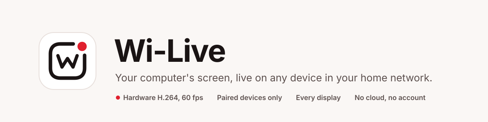
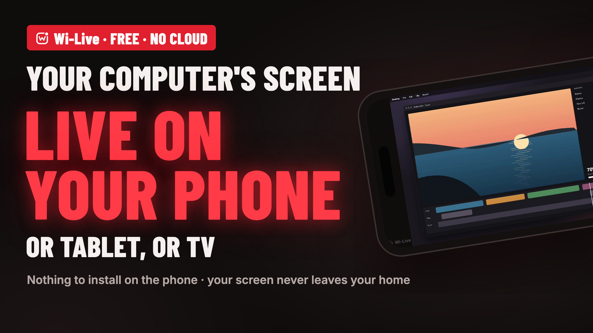
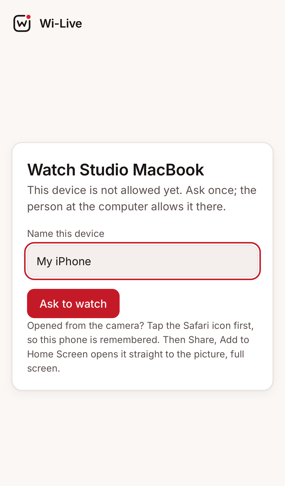
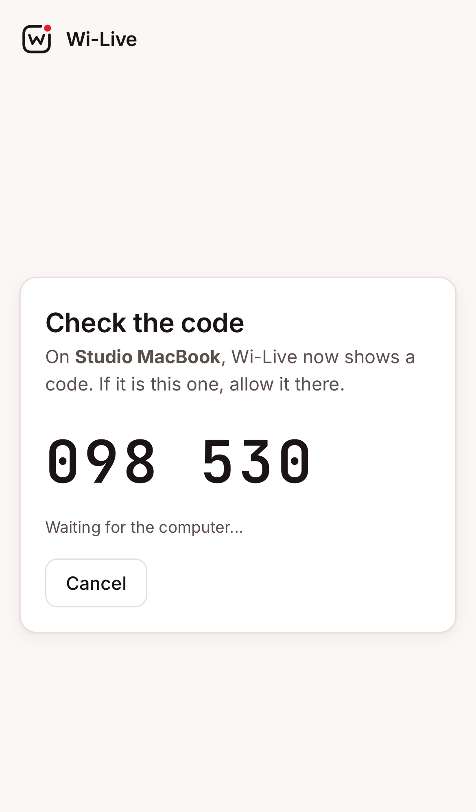
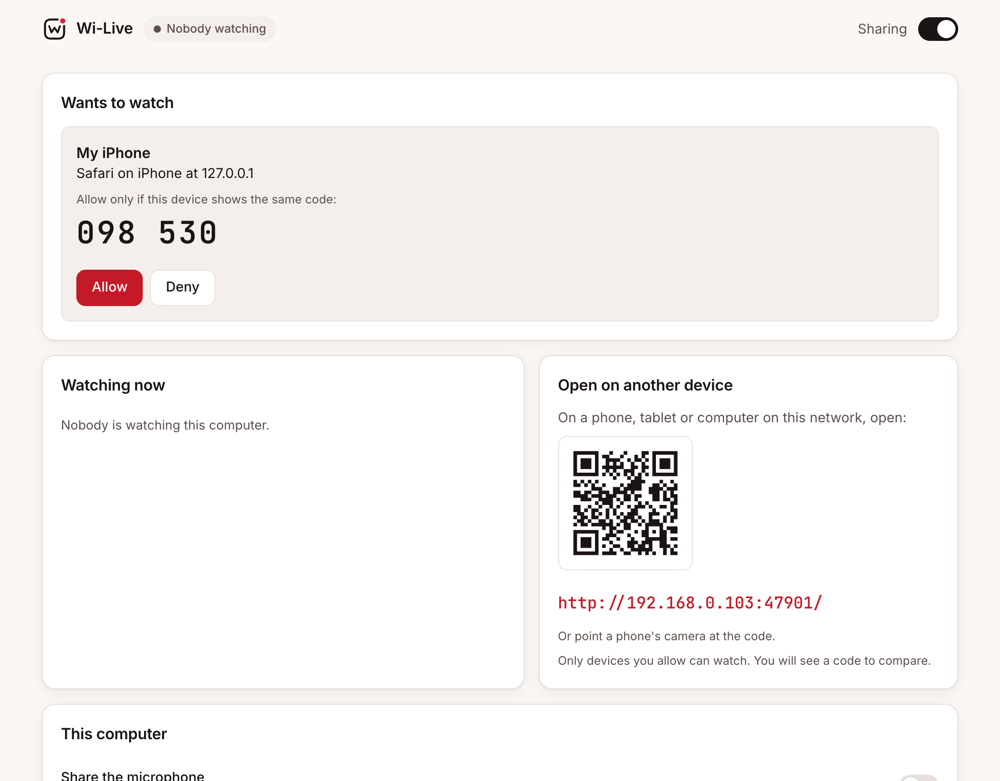
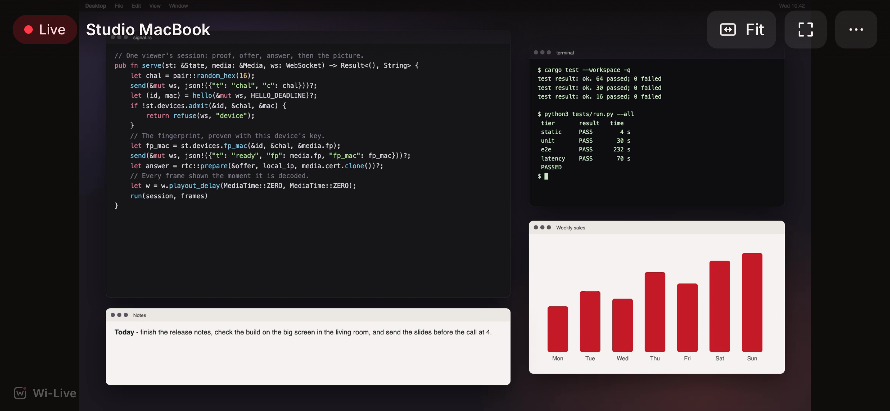
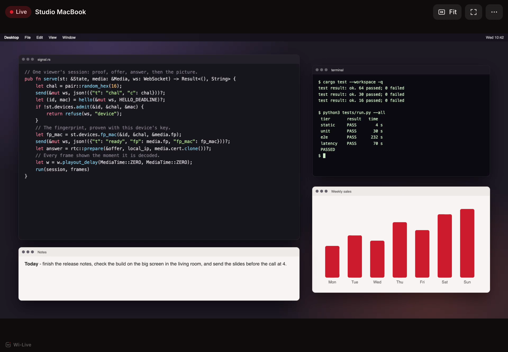
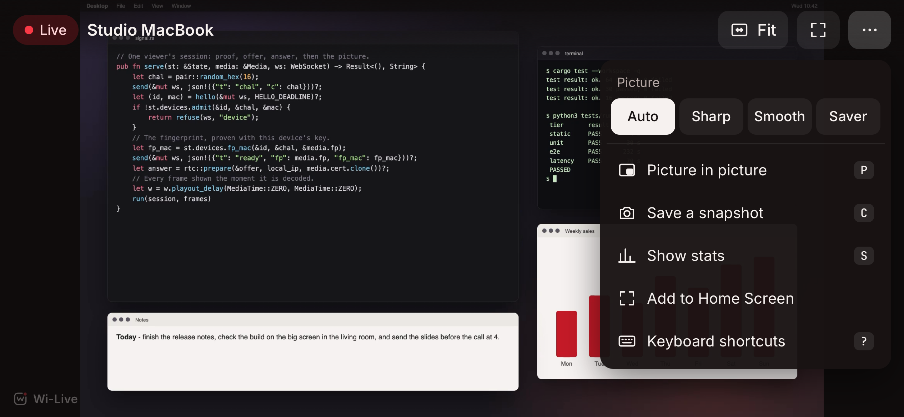
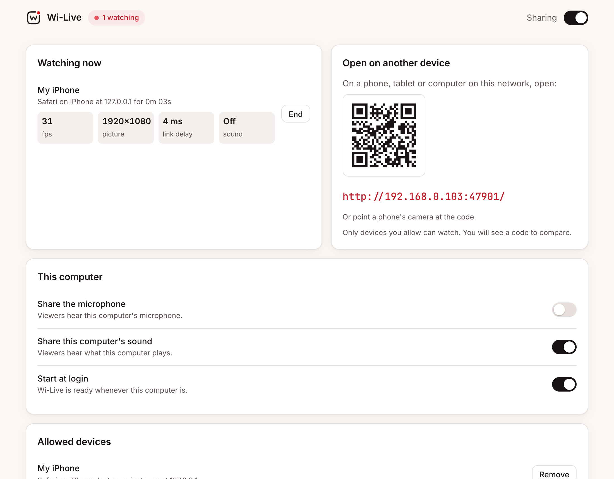
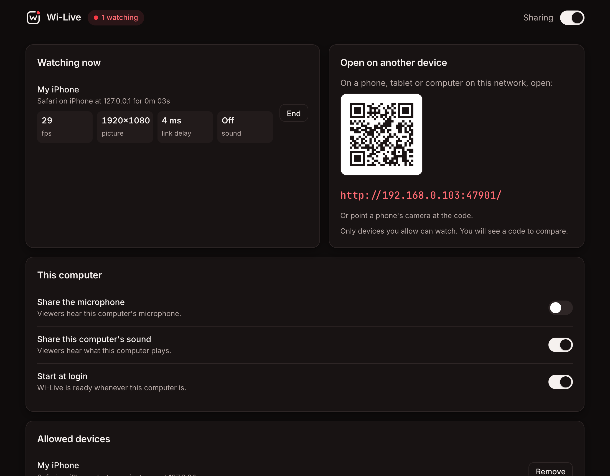

<p align="center">
  <picture>
    <source media="(prefers-color-scheme: dark)" srcset="docs/assets/banner-dark.svg">
    <source media="(prefers-color-scheme: light)" srcset="docs/assets/banner-light.svg">
    
  </picture>
</p>

# Wi-Live

**Your computer's screen, sound and microphone, live on any phone, tablet, TV or
computer in your home network. Nothing to install on the device that watches.**

Wi-Live runs quietly in your computer's menu bar or tray. On any device in the same
home network, open its address (or point the camera at its QR code), compare a
six-digit code once, and you are watching. After that, the device goes straight to
the picture.

```
   phone / tablet / TV / laptop  ◀──── home Wi-Fi ────  your computer
        (any browser)            hardware H.264,          (Wi-Live:
                                  WebRTC, encrypted        menu bar app)
```

There is no account, no cloud and no subscription. Everything stays inside your home
network: your computer is the only server.

---

## See it in eight minutes

[](https://youtu.be/-Lewe88a9JE)

Installing it, pairing a phone once with a six-digit code, the four picture modes, every
display at once, who can watch, and how fast it is, measured.
**[Watch on YouTube](https://youtu.be/-Lewe88a9JE)** (7:51)

---

## Contents

- [See it in eight minutes](#see-it-in-eight-minutes)
- [What it looks like](#what-it-looks-like)
- [What it does](#what-it-does)
- [Install](#install)
- [Who can watch: security](#who-can-watch-security)
- [How fast it is, measured](#how-fast-it-is-measured)
- [Every device, every screen](#every-device-every-screen)
- [How it works](#how-it-works)
- [Build and test](#build-and-test)
- [Releases and updates](#releases-and-updates)
- [Licence](#licence)

---

## What it looks like

<table>
<tr>
<td align="center" width="33%"><br><b>Ask once</b><br><sub>Name the device, ask to watch</sub></td>
<td align="center" width="33%"><br><b>Compare a code</b><br><sub>The same six digits appear on the computer</sub></td>
<td align="center" width="33%"><br><b>Allow on the computer</b><br><sub>Only you decide who watches</sub></td>
</tr>
</table>

<p align="center"><br>
<sub>On a phone held sideways: the controls fade away and stay clear of the notch.</sub></p>

<table>
<tr>
<td align="center" width="50%"><br><b>On a tablet</b><br><sub>Pinch to zoom, drag to look around</sub></td>
<td align="center" width="50%"><br><b>Your picture, your way</b><br><sub>Auto, Sharp (full size), Smooth or Saver; picture in picture; snapshots</sub></td>
</tr>
<tr>
<td align="center" width="50%"><br><b>Who is watching, live</b><br><sub>Each device, its picture, its delay; end it in one tap</sub></td>
<td align="center" width="50%"><br><b>Light and dark</b><br><sub>Both meet WCAG AA contrast, checked by a test</sub></td>
</tr>
</table>

---

## What it does

- **Your screen, live.** Hardware H.264 at up to 60 fps. On a slow link the picture gets
  smaller, never late: nothing is ever queued.
- **Every display.** Watch any one, or all of them at once as screens shaped like the
  real ones (grid, row, column or focus; drag to arrange; remembered per device).
- **Sound and microphone.** The computer's sound, its microphone, each on or off.
- **Your picture, your way.** Auto (fast), Sharp (a Retina or 4K screen at its own size),
  Smooth (fluid on weaker Wi-Fi), Saver (the least data). Pinch, scroll or keyboard zoom.
  Picture in picture. Snapshots. Keyboard shortcuts for everything.
- **Phones done properly.** Open it by QR code; remembered after the first time; full
  screen on iPhone; Add to Home Screen for an app-like icon; controls that never sit
  under the notch.
- **The owner stays in charge.** Who is watching, live, in your window; a red dot in the
  menu bar whenever anyone is; end a viewer, remove a device, or pause everything in one
  tap; an activity log that stays on your computer.
- **Updates itself, safely.** A daily check; the release's signature is checked against
  the key built into the app before anything else; nothing installs until you choose.

---

## Install

From [Releases](https://github.com/san-gitlogin/Wi-Live/releases/latest):

| Computer | File | Then |
|---|---|---|
| macOS 12.3 or later | `Wi-Live-<version>-macos.dmg` | Drag Wi-Live to Applications, open it, allow Screen Recording once |
| Windows 10 / 11 | `wilive-windows-x86_64.exe` | Run it; allow it on private networks when Windows asks |
| Linux (x86_64, ARM64) | `wilive-linux-<arch>` | Run `package/fetch-openh264.sh` once (Cisco's H.264 encoder), then the app |

Then, on the device you want to watch from, open the address the app shows, or scan
its QR code.

**Check what you downloaded** (every release is signed):

```
shasum -a 256 -c SHA256SUMS --ignore-missing
openssl dgst -sha256 -verify release.pub.pem -signature SHA256SUMS.sig SHA256SUMS
```

`release.pub.pem` must match `tools/release_keys.json` in this repository.

---

## Who can watch: security

Being on your Wi-Fi is never enough to watch.

- **Paired devices only.** A new device and your computer each show a six-digit code; you
  compare them and allow it on the computer (numeric comparison with a commitment, the
  Bluetooth LE Secure Connections pattern). The device keeps its own key.
- **Every session proves the key** with a fresh challenge; a replayed proof fails.
- **The media is encrypted** (DTLS-SRTP), and the page refuses media whose fingerprint was
  not proven with the device's key.
- **Bounded against abuse:** home-network addresses only, capped connections and sizes,
  deadlines on every read, a lockout after repeated wrong proofs (never for your own window).
- **Nothing leaves your network,** and no key or code is ever written to a log.

Details: [docs/DESIGN.md](docs/DESIGN.md), [docs/DECISIONS.md](docs/DECISIONS.md).

---

## How fast it is, measured

Latency is measured, never claimed: the test picture carries the time each frame was
made, and real Chrome reads it back from every frame it shows (`tests/latency`).

| | typical (p50) | worst 1% (p99) |
|---|---|---|
| 1080p60, test picture, this computer | 19-21 ms | 27-30 ms |
| A real screen, end to end (`tests/real_latency.py`) | 52-72 ms | 69-82 ms |

The real-screen figure includes the time the screen itself takes to draw and macOS takes
to capture it. Sharp (full Retina size) costs more and is your choice: about 35-58 ms.

---

## Every device, every screen

Tested on every run: phones upright and sideways (iPhone SE to iPhone 13 sizes, with a
simulated notch), tablets, laptops and 1440p monitors, light and dark; Chrome and
Safari's engine (WebKit); browsers back to iOS 12.2 Safari and Chrome 70 (a guard test
fails on anything newer).

---

## How it works

```
 viewer (browser)                         your computer (wilive)
   │  GET /            the dashboard  ◀──   one port, home network only
   │  pair once        X25519 + SAS   ◀──   the owner allows in the window
   │  ws /v1/signal    challenge, proof, SDP offer and answer
   ◀═══════════════  WebRTC: H.264 + Opus, DTLS-SRTP, playout delay 0
```

Written in Rust: `wilive-core` (pairing, devices, the log, updates), `wilive-stream`
(capture, encode, WebRTC; grown from HID-Fi Companion), `wilive-server` (one port for
everything), `wilive` (the app: tray, window, updates). The dashboard is one small page
with no framework and nothing loaded from the internet.

---

## Build and test

```
cargo build --release -p wilive
python3 tests/run.py            # static + unit: fmt, clippy (3 OSes), Rust tests, page crypto
python3 tests/run.py --all      # + every browser tier: pairing, security, tampering, phones,
                                #   every screen size, endurance, updates, latency
```

Windows and Linux are tested from a Mac in VMs (`tests/windows`, `tests/linux`) and in
CI on macOS, Windows, and Linux x86_64 and ARM64. Where it stands:
[docs/PROGRESS.md](docs/PROGRESS.md).

---

## Releases and updates

Every release is built by CI on its own OS, checked file by file, and signed: the macOS
app with Wi-Live's own certificate, and SHA256SUMS with the release key. The app checks
that signature before it offers an update. [docs/RELEASING.md](docs/RELEASING.md).

---

## Licence

PolyForm Noncommercial 1.0.0 ([LICENSE.md](LICENSE.md)). Fonts: Inter and JetBrains
Mono, SIL OFL 1.1.
